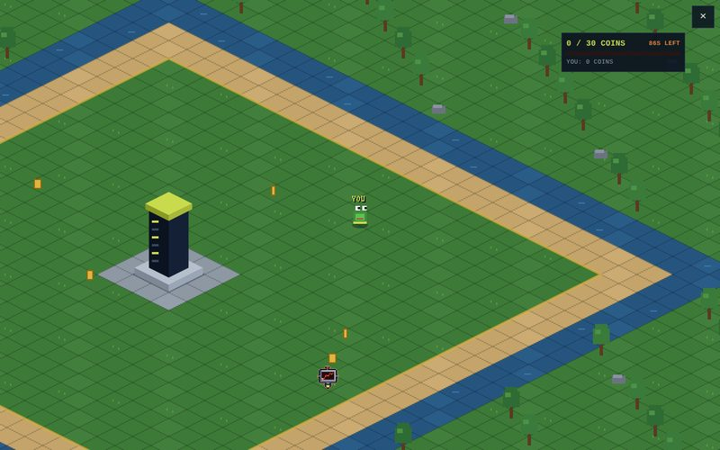
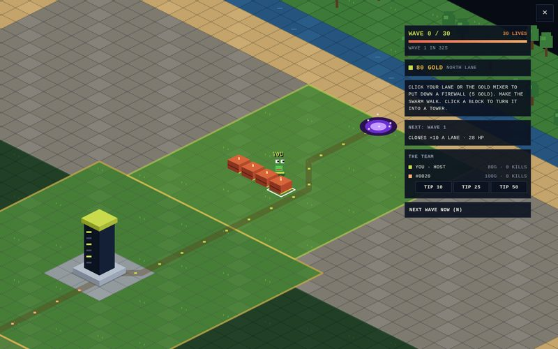
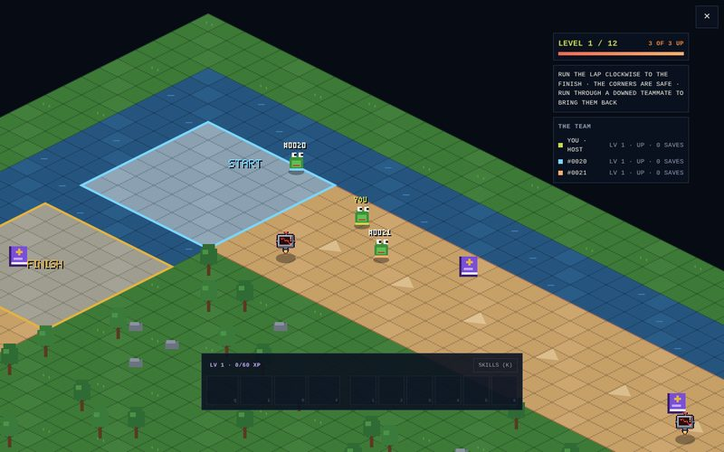

# OG Club World game kit

Make games for [OG Club World](https://world.ogclub.online), the pixel world where Swarm Pepe holders hang out,
build clubs and play. This kit has everything a game needs to drop into the world: the engine pieces games plug
into, three complete games to learn from, a page to playtest in your browser (with bots and fake lag), headless
balance bots, and the checks every game must pass. It's written so AI agents can build games with it as well as
people.

| | | |
|---|---|---|
|  |  |  |
| **COIN DASH**: the starter game (small, every file explained) | **SWARM SIEGE**: co-op lane maze defence, one lane each | **RUN PEPE RUN**: team dodging laps, levels, skills, items |

## Quick start

Node 22 or newer, nothing to install.

```sh
npm run play                 # then open http://localhost:5173/?game=template
npm run new my-game mg       # a new game from the template, with the message prefix "mg"
npm test                     # every game plays through the local server, plus each game's own tests
npm run check                # the rules every game keeps (no network, no wallets, no outside code...)
npm run sim                  # balance bots play every game for 1, 2 and 4 players
```

## What's here

```
engine/       what games plug into (don't change it in a game's pull request)
  world.js      the map size, tile kinds, the Watcher, a seeded random generator, sendAll
  local.js      runs a round the way the world's server does (tests, sims, the playtest page)
  host.js       the playtest page's stand-in for the world's town engine (map, Pepes, camera, input)
  sprites.js    the swarm's cast (shillers, clones, FUD bots, rug pullers, extractors...)
  text.js       pixel text;  motion.js  smooth movement;  sound.js  the world's sounds
  play.html, style.css, serve.js
games/        one folder per game: game.json, rules.js, round.js, client.js, panel.html, sim.js, test/
scripts/      check.js, sim.js, new-game.js
```

## Making a game

Read **[BUILDING_A_GAME.md](BUILDING_A_GAME.md)**: how a game runs, what each file exports, what a game may not
do, how to test it, and the checklist. To ask someone (or an agent, or the swarm) for a game, fill in
**[BRIEF_TEMPLATE.md](BRIEF_TEMPLATE.md)**.

New games come in as pull requests adding a folder to `games/`. The checks run on every pull request; OG Club
plays and reviews each game, merges the good ones, and wires them into the world (the games list, $SWARM
payouts, leaderboards).
